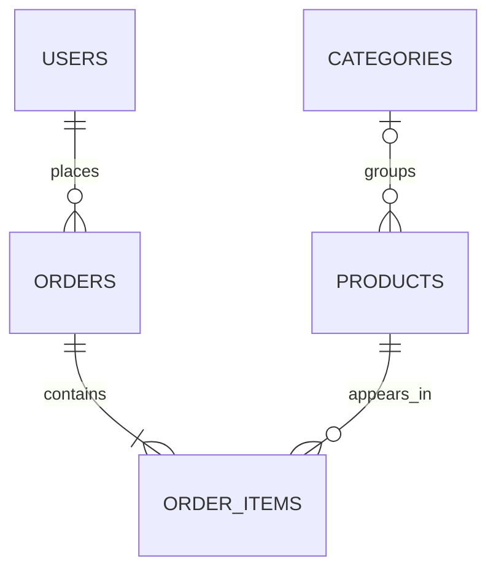

# Database relationships

The demo schema keeps the first version focused on accounts, categories, products, orders, and order items. Addresses, wishlist, reviews, coupons, and payment provider integration are natural extensions described by the supplied project guide.
