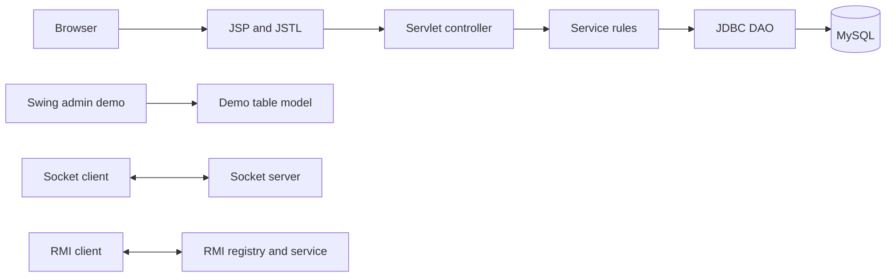

# RTU syllabus mapping

| Syllabus area | ShopSphere demonstration |
|---|---|
| Swing, MVC, controls and pluggable look and feel | `swing/AdminDemo` builds a desktop product table with text input, buttons, checkbox, radio buttons, combo box, dialogs, and system look and feel. |
| Applets | Historical note below; applets are not part of the runnable application because browsers and current JDKs no longer support the old plug-in model. |
| `java.sql`, JDBC driver and database programming | `dao/ProductDAO`, `dao/UserDAO`, `util/Database`, and `database/shopsphere.sql` use JDBC, Connector/J, prepared statements, and try-with-resources. |
| `java.net`, client/server, content and protocol handlers | `network/InventoryServer` and `InventoryClient` use `ServerSocket`/`Socket`; `demo/UrlConnectionDemo` shows URL protocol selection and content type. |
| RMI, registry and naming | `rmi/InventoryServerMain` binds `ShopSphereInventory` in the registry; `InventoryClientMain` looks it up by name. |
| Serialization | `demo/SerializationDemo` serializes a `Product` instance to bytes and restores it. Network serialization should only be used with trusted inputs. |
| JNDI | `demo/JndiDemo` looks up a Tomcat resource using `java:comp/env/jdbc/ShopSphereDB`; a matching Tomcat resource must be configured to run it. |
| Internationalization | `messages_en.properties`, `messages_hi.properties`, and `demo/I18nDemo` demonstrate `Locale` and `ResourceBundle`. |
| J2EE, HTTP, web container and n-tier design | The WAR runs on Tomcat. Requests pass through a servlet to service and DAO code, then JDBC/MySQL. |
| Servlet lifecycle, config/context, request/response, sessions, events and filters | Servlet annotations and `listener/AppListener` demonstrate lifecycle and application context; the session holds account/cart state; `AuthenticationFilter` and `AdminFilter` protect routes. |
| JSP lifecycle, elements, EL, JSTL, fragments and tag files | JSP views use EL, JSTL Core/Formatting, shared `.jspf` fragments, and tag files under `WEB-INF/tags`. Traditional declaration/scriptlet syntax belongs in the written viva example below, not in business pages. |
| JSTL XML and SQL libraries | See the isolated syllabus examples below. The store itself uses DAO/JDBC so database work does not leak into JSP. |

## Applet note

An applet was a small Java program hosted by a browser plug-in. Current browsers do not provide the plug-in runtime, and applet APIs were removed from modern JDKs. ShopSphere therefore explains the historical architecture but does not pretend that an applet can be launched from the current web app. Swing is used for the runnable desktop UI demonstration.

## JSP syllabus snippets

The web views demonstrate JSP through EL and JSTL. The older syntax can be explained in a small classroom-only snippet:

```jsp
<%! private int visitCount = 0; %>
<% String label = "Student"; %>
<%= label %>
<%-- JSP comment --%>
```

Avoid mutable fields and scriptlets in a real JSP: a JSP servlet instance serves concurrent requests. Keep Java logic in controllers and services.

JSTL SQL is an isolated syllabus feature; a production page should use the existing DAO layer:

```jsp
<%@ taglib prefix="sql" uri="jakarta.tags.sql" %>
<sql:query var="rows" dataSource="${applicationScope.demoDataSource}">
  SELECT name FROM products WHERE active = TRUE
</sql:query>
```

JSTL XML can transform or inspect a supplied XML feed with `jakarta.tags.xml`. XML and SQL tags are not needed by the main application; use them in a separate classroom page after configuring a demo datasource. JSTL Functions are available under `jakarta.tags.functions` for operations such as `fn:contains` and `fn:length`.

## Architecture



The Swing, socket, and RMI samples are intentionally small independent demos. The web store is the runnable end-to-end flow.
